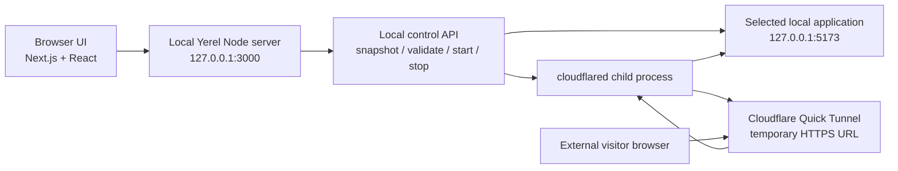

# Yerel

> **Your localhost. Out in the world.**


Yerel is a local-development sharing tool. It helps you make one web application running on your own computer reachable through a temporary public HTTPS URL, without deploying that application to a hosting platform.

The name **Yerel** comes from the Turkish word for **“local.”** That is the product's purpose: keep the application on your machine while making a deliberately selected local service reachable to someone else for a short-lived development session.

Yerel is a browser interface backed by a small local Node.js server. The server validates a loopback target and starts the official `cloudflared` executable to create a Cloudflare Quick Tunnel. The project does not provide permanent hosting, user accounts, custom domains, or a hosted control plane.

## Table of contents

- [What is Yerel?](#what-is-yerel)
- [Why does Yerel exist?](#why-does-yerel-exist)
- [How it works](#how-it-works)
- [Features](#features)
- [Who is Yerel for?](#who-is-yerel-for)
- [Requirements](#requirements)
- [Installation](#installation)
- [Quick start](#quick-start)
- [First sharing session](#first-sharing-session)
- [Configuration and environment variables](#configuration-and-environment-variables)
- [Usage and operating guide](#usage-and-operating-guide)
- [Local API reference](#local-api-reference)
- [Security and privacy](#security-and-privacy)
- [Limitations](#limitations)
- [Troubleshooting](#troubleshooting)
- [Development setup](#development-setup)
- [Project structure](#project-structure)
- [Testing and verification](#testing-and-verification)
- [Production and deployment guidance](#production-and-deployment-guidance)
- [FAQ](#faq)
- [Contributing](#contributing)
- [Reporting bugs and requesting features](#reporting-bugs-and-requesting-features)
- [License](#license)
- [Acknowledgments and external dependencies](#acknowledgments-and-external-dependencies)

## What is Yerel?

When you develop a website, it often runs at an address such as:

```text
http://127.0.0.1:5173
```

This address normally means “port 5173 on this computer.” Another person cannot generally open it and reach your application because `127.0.0.1` and `localhost` refer to *their* computer when viewed from their browser.

Yerel creates a temporary route between a public HTTPS address and one local HTTP or HTTPS service that you explicitly select.

For example:

1. You run a development application at `http://127.0.0.1:5173`.
2. Yerel confirms that the service responds.
3. You approve making that service public.
4. `cloudflared` establishes a Quick Tunnel.
5. Cloudflare provides an address such as `https://example-name.trycloudflare.com`.
6. You share that temporary address.
7. You stop sharing when you are finished.

The application remains on your computer. Your computer, the local application, network connection, Yerel process, and tunnel must remain operational while the link is in use.

## Why does Yerel exist?

Yerel is useful when deploying a project would be unnecessary or too slow for the immediate task:

- Demonstrating a local project to a teammate.
- Showing a prototype or work in progress.
- Reviewing a page on another device.
- Sharing a development interface during a short feedback session.
- Testing a local HTTP endpoint from an external browser, where the endpoint and its authentication behavior support that use.

These are development-sharing use cases, not a replacement for production hosting. Whether webhooks, OAuth callbacks, WebSockets, absolute URLs, or origin-bound cookies work depends on the application being shared and its own development configuration. Yerel's MVP shares one selected HTTP service directly; it does not provide a general full-stack reverse proxy.

### Is Yerel right for you?

Yerel is a good fit if you:

- Already have a local web service running.
- Need a temporary link rather than permanent hosting.
- Are comfortable installing Node.js and `cloudflared`.
- Understand that the generated URL is a public route to the selected service.

A conventional deployment platform is more appropriate for permanent availability, durable URLs, managed authentication, custom domains, team access, or production traffic.

## How it works

### Simple explanation

1. Your application runs on your computer.
2. Yerel checks that the chosen local address responds.
3. The local Yerel server starts `cloudflared` as a child process.
4. `cloudflared` makes an outbound connection to Cloudflare's tunnel infrastructure.
5. Cloudflare returns a temporary public HTTPS address.
6. Requests to that address travel through the tunnel to the selected local service.
7. Stopping Yerel or stopping the session terminates the local tunnel process.

This is not permanent deployment. The public address may change between sessions, and the service is unavailable when the local process or tunnel is unavailable.

### Technical architecture



The components have separate responsibilities:

- **Browser UI:** presents the landing page and workspace, requests state, and sends sharing commands.
- **Yerel Node server:** serves Next.js and owns the local control API. It does not expose a general shell or filesystem API.
- **Control API:** validates requests, validates the selected local target, reports engine/session state, and starts or stops sharing.
- **Selected local application:** the one service the user entered and approved. Yerel does not automatically expose every listening port.
- **`cloudflared`:** the locally installed executable that creates and monitors the Quick Tunnel.
- **Cloudflare:** supplies the temporary public HTTPS route. Cloudflare is not a Yerel-hosted gateway.
- **External visitor:** reaches the generated public URL while the tunnel and local target remain available.

The current implementation uses one long-running Node process in both development and production. It does not use Electron, Tauri, a database, or a separate hosted backend.

### Current project status

Yerel is an actively developed local-development tool rather than a hosted production service. The repository's current automated checks were run while preparing this document:

```text
npm run typecheck  PASS
npm test           PASS — 3 test files, 12 tests
npm run lint       PASS
npm run build      PASS
```

These checks do not prove that a live Cloudflare tunnel works in every environment. A real tunnel smoke test still requires the executable, network access, and a running local target. Before a public production deployment, review dependency advisories with `npm audit`; the current dependency tree has reported advisories that should be evaluated and remediated before exposing a server beyond loopback.

## Features

The current implementation includes:

- Loopback-only target validation for `localhost`, `127.0.0.1`, and `::1`.
- HTTP and HTTPS target support.
- Rejection of credentials and URL fragments in target URLs.
- Rejection of Yerel's own control port.
- Cloudflare executable discovery through `PATH` and Windows `PATHEXT`.
- Explicit executable configuration through `YEREL_CLOUDFLARED_PATH`.
- Safe executable invocation using argument arrays rather than shell command concatenation.
- Local target reachability checks before tunnel startup.
- Real Cloudflare Quick Tunnel startup.
- Strict extraction of a `trycloudflare.com` HTTPS URL from provider output.
- A registered-connection requirement before reporting the tunnel as active.
- Startup timeout handling.
- Duplicate-start protection.
- Cancellation and stop-during-start handling.
- Unexpected tunnel-process exit reporting.
- Copy and open actions for an actual public URL.
- Explicit consent before starting a public sharing session.
- Engine availability and tunnel activity indicators in the workspace.
- Host and Origin validation for local control requests.
- Bounded JSON request bodies.
- Graceful shutdown cleanup when the Node process receives termination signals.
- Responsive landing page and workspace using the supplied Yerel branding, forest image, display font, and ghost logo.

The automated tests cover target validation, API security behavior, executable discovery, URL parsing, and fake-process tunnel lifecycle behavior. A real public tunnel requires the external `cloudflared` executable and network access.

The project does **not** currently provide persistent URLs, custom domains, accounts, team collaboration, analytics, session history that survives restarts, multiple concurrent tunnels, password protection, a multi-service reverse proxy, automatic binary installation, or native desktop integration.

## Who is Yerel for?

Yerel is intended for:

- Students demonstrating a project.
- Developers showing a prototype.
- People learning web development.
- Small teams reviewing local work.
- Technical users testing a local HTTP application from another browser or device.

You do not need deep networking knowledge to use the interface, but you do need a running local service, Node.js, and the `cloudflared` executable for real sharing.

## Requirements

### Required software

- Node.js and npm. The repository does not declare an `engines` field, so the exact minimum Node version is not enforced by package metadata. The current project uses modern Node APIs and should be run with a current Node.js LTS release. Node.js 20 or newer is the practical recommendation.
- A current npm version compatible with your Node.js installation.
- `cloudflared` installed locally for real tunnel creation.
- A network connection that permits the Cloudflare Quick Tunnel connection.
- A local HTTP or HTTPS application to share.

Cloudflare's official installation documentation is available at:

<https://developers.cloudflare.com/cloudflare-one/connections/connect-networks/downloads/>

### Cloudflare account and domain

The current Yerel flow uses Cloudflare Quick Tunnels through the `cloudflared tunnel --url ...` command. It does not ask the user for a Cloudflare API token, purchased domain, or custom DNS configuration.

Cloudflare's service terms, availability, and Quick Tunnel limits still apply. Yerel does not promise unlimited usage, permanent URLs, or guaranteed uptime.

### Tested platform status

The documented workflow has been exercised on Windows PowerShell. The code uses Node.js HTTP, HTTPS, filesystem, and child-process APIs and may work on other operating systems, but this repository does not currently provide a cross-platform CI matrix or equivalent end-to-end evidence. Treat macOS and Linux support as unverified rather than officially guaranteed.

## Installation

### 1. Install Node.js

Install a current Node.js LTS release from the official website:

<https://nodejs.org/en/download>

Verify the installation:

```powershell
node --version
npm --version
```

### 2. Obtain the repository

Clone the repository using its actual repository URL if one is available to you, then enter the checkout directory:

```powershell
git clone <your-Yerel-repository-url>
cd yerel
```

The repository currently does not declare a public repository URL in its metadata, so the URL above is intentionally a placeholder for the location where you obtained the source. Do not use it literally.

### 3. Install dependencies

Use the lockfile-aware install command:

```powershell
npm ci
```

Use `npm install` instead when you intentionally need npm to update the lockfile during development.

### 4. Install or locate `cloudflared`

Install `cloudflared` using Cloudflare's official documentation. Verify it in PowerShell:

```powershell
cloudflared --version
```

If PowerShell can run it but Yerel cannot find it, configure the executable explicitly for the current PowerShell session:

```powershell
$env:YEREL_CLOUDFLARED_PATH = "C:\Program Files (x86)\cloudflared\cloudflared.exe"
```

The path is only an example. Replace it with the path on your computer. Quoted Windows paths containing spaces are supported. This environment variable is temporary for the current terminal session unless you configure it persistently through Windows environment settings.

### 5. Start Yerel

```powershell
npm run dev
```

Open:

```text
http://127.0.0.1:3000
```

`http://localhost:3000` is also accepted by the local control API when the server is using its default port.

## Quick start

The following workflow creates a small local test page without adding a project dependency.

### Terminal 1: start Yerel

```powershell
cd <path-to-your-yerel-checkout>
npm ci
$env:YEREL_CLOUDFLARED_PATH = "C:\Program Files (x86)\cloudflared\cloudflared.exe"
npm run dev
```

Leave this terminal running.

### Terminal 2: start a test application

```powershell
node -e "require('http').createServer((req,res)=>{res.writeHead(200,{'content-type':'text/html; charset=utf-8'});res.end('<h1>Yerel test app</h1><p>The local service is reachable.</p>')}).listen(5173,'127.0.0.1',()=>console.log('Test app: http://127.0.0.1:5173'))"
```

Leave this terminal running too.

### Browser

1. Open `http://127.0.0.1:3000`.
2. Choose **Get Started**.
3. Enter `http://127.0.0.1:5173`.
4. Confirm the consent statement explaining that the selected service will become public.
5. Choose **Start sharing**.
6. Wait for the actual `https://*.trycloudflare.com` URL.
7. Open the URL in another browser tab or private window.
8. Confirm that the test page appears.
9. Return to Yerel and choose **Stop sharing**.
10. Stop the test server with `Ctrl+C` in Terminal 2.
11. Stop Yerel with `Ctrl+C` in Terminal 1.

If you use a real application instead of the test server, replace `http://127.0.0.1:5173` with that application's actual local URL.

## First sharing session

### Find the local URL

Most development servers print a URL when they start. A URL consists of a protocol, a host, and often a port:

```text
http://127.0.0.1:5173
│    │           │
│    │           └─ port: the numbered entry used by the application
│    └──────────── host: this computer
└───────────────── protocol
```

A port is a numbered communication endpoint. Different local applications can listen on different ports at the same time.

### Review consent

The local URL is normally private to the computer. Starting a tunnel changes that: the selected service becomes reachable through a public address. The consent checkbox is required before the start action is enabled.

### Start and monitor sharing

The workspace reports separate concepts:

- **Engine ready:** Yerel found and launched a version check for `cloudflared`.
- **Engine unavailable:** the executable was not found or could not be launched.
- **Tunnel active:** a real public URL was obtained and the tunnel is considered ready.

The engine being ready does not mean a tunnel is active. The tunnel becomes active only after provider output has supplied a valid URL and the local target remains reachable.

### Use the public URL

The public URL is different from the local URL:

```text
Local:  http://127.0.0.1:5173
Public: https://<temporary-name>.trycloudflare.com
```

Copy the public URL or open it directly from the active sharing card. The full URL is retained for the copy and open operations even when the display truncates a long value.

### Stop sharing

Choose **Stop sharing** in the workspace. Yerel asks the tunnel process to terminate and updates the session state after process termination is observed or an error is reported. Provider-side URL invalidation can take a short amount of time; do not assume the address disappears instantaneously.

## Configuration and environment variables

The current source reads these environment variables:

| Variable | Purpose | Required? | Default | Example | Scope |
|---|---|---:|---|---|---|
| `YEREL_CLOUDFLARED_PATH` | Explicit path to the `cloudflared` executable | Optional if PATH discovery works | `cloudflared` lookup | `C:\Program Files (x86)\cloudflared\cloudflared.exe` | Local Node process |
| `HOST` | Hostname used by the local Node server | Optional | `127.0.0.1` | `127.0.0.1` | Local Node process |
| `PORT` | Port used by the local Node server | Optional | `3000` | `4317` | Local Node process |
| `NODE_ENV` | Used with the startup mode to determine Next development behavior | Usually optional | Controlled by the script/flags | `production` | Local Node process |
| `PATH` | Used for automatic executable discovery | Platform-provided | Operating-system PATH | System-specific | Local Node process |
| `PATHEXT` | Windows executable extensions used during lookup | Platform-provided on Windows | `.COM;.EXE;.BAT;.CMD` fallback | System-specific | Local Node process |

### Safe HOST configuration

Yerel is designed to bind to loopback by default:

```powershell
$env:HOST = "127.0.0.1"
```

Do not bind the control server to `0.0.0.0` or a LAN address unless you have designed and implemented an authenticated access model. The current Origin and Host checks are intended to protect a loopback control service, not to turn an unauthenticated server into a network service.

### Changing the application port

```powershell
$env:PORT = "4317"
npm run dev
```

Open the matching address:

```text
http://127.0.0.1:4317
```

The selected application being shared must use a different port from Yerel's control server.

## Usage and operating guide

### If the engine is available

The workspace displays **Engine ready**. This means the local executable was found and responded to the version check. It does not guarantee that a tunnel can start; the target must also be reachable and Cloudflare must accept the connection.

### If the engine is unavailable

Check the startup log. The application distinguishes between:

- `cloudflared` not found through the configured path or PATH/PATHEXT lookup.
- An executable found at a path but unable to launch.

Set `YEREL_CLOUDFLARED_PATH` to the full executable path and restart Yerel.

### If the local target becomes unavailable

The target is checked before startup and again before readiness. After a tunnel is active, the local service may still stop independently. The tunnel process and provider state are not a substitute for application health monitoring.

### If the tunnel exits unexpectedly

The server records an error state and does not silently continue to report the session as active. Start a new session after resolving the provider or target problem.

### If Yerel stops

The shutdown handler attempts to stop the tunnel. A hard machine shutdown, forced process termination, or system crash can prevent graceful cleanup. A restarted Yerel process does not restore an old session as active.

## Local API reference

The API is an internal local control API used by the browser interface. It is not a public remote-control API and is not intended to be exposed through the tunnel.

All API requests require a valid loopback `Host` value on Yerel's configured port. Mutating requests also require a loopback `Origin` and JSON content type where a request body is used.

### `GET /api/snapshot`

Returns the current in-memory engine, tunnel, and activity state.

Example:

```http
GET /api/snapshot HTTP/1.1
Host: 127.0.0.1:3000
```

The response shape is based on `DesktopSnapshot` in `shared/types.ts`:

```json
{
  "tunnel": {
    "state": "idle"
  },
  "activity": [],
  "cloudflared": {
    "available": true,
    "path": "C:\\Program Files (x86)\\cloudflared\\cloudflared.exe",
    "version": "cloudflared version 2026.10.0"
  }
}
```

The executable path and version are local diagnostic information. The endpoint is protected by the local API checks but should not be exposed to an untrusted network.

### `POST /api/validate`

Validates a selected local target without starting a tunnel.

Required headers:

```http
Host: 127.0.0.1:3000
Origin: http://127.0.0.1:3000
Content-Type: application/json
```

Request body:

```json
{
  "url": "http://127.0.0.1:5173"
}
```

Successful response:

```json
{
  "ok": true,
  "target": {
    "url": "http://127.0.0.1:5173",
    "port": 5173,
    "protocol": "http",
    "host": "127.0.0.1"
  }
}
```

Invalid target responses use the same `200` response path with an error object:

```json
{
  "ok": false,
  "error": "For safety, the target must point to localhost."
}
```

The validator accepts HTTP and HTTPS loopback targets, rejects credentials and fragments, validates ports, and rejects Yerel's own control port.

### `POST /api/session/start`

Validates the target again and starts a real tunnel. The browser must have completed the consent step before making this request.

Required headers and body are the same as `/api/validate`:

```json
{
  "url": "http://127.0.0.1:5173"
}
```

On success, the response is a `TunnelStatus` object similar to:

```json
{
  "state": "active",
  "url": "https://temporary-name.trycloudflare.com",
  "pid": 12345,
  "startedAt": "2026-10-11T12:00:00.000Z",
  "target": {
    "url": "http://127.0.0.1:5173",
    "port": 5173,
    "protocol": "http",
    "host": "127.0.0.1"
  }
}
```

The URL is returned only after valid provider output, a registered tunnel connection, and a reachability check. Startup failures are returned as an error response, commonly HTTP `409` for a tunnel operation failure.

### `POST /api/session/stop`

Stops the current tunnel. It requires a loopback Host and Origin but does not require a request body.

```http
POST /api/session/stop HTTP/1.1
Host: 127.0.0.1:3000
Origin: http://127.0.0.1:3000
```

The response is the resulting `TunnelStatus`, normally with:

```json
{
  "state": "stopped"
}
```

The API has a small JSON body limit and rejects invalid Host, Origin, method, content-type, or JSON input before processing the operation.

## Security and privacy

### What public sharing means

A local address such as `http://127.0.0.1:5173` normally points only to your own computer. Yerel creates a public route to the selected service. Anyone who receives the generated URL may be able to reach that service while the tunnel is active, depending on the application's own authentication and authorization.

HTTPS protects data in transit between the visitor and the public endpoint. HTTPS does **not** automatically:

- Authenticate visitors.
- Add a password to your application.
- Protect administrative routes.
- Remove vulnerabilities from the application.
- Make development data safe to expose.

The temporary URL is not equivalent to authentication and should not be treated as a guaranteed secret. It can be copied, forwarded, logged by an application, or exposed accidentally.

Only expose services you are authorized to share. Do not share an application containing:

- Production credentials.
- Private personal information.
- Administrative consoles.
- Debug endpoints.
- Unprotected databases or internal APIs.
- Confidential files or test data.

Stop sharing as soon as the review or demonstration is complete.

### Protections implemented by Yerel

The current code provides these protections:

- Default loopback server binding.
- Loopback-only target validation.
- Rejection of non-HTTP/HTTPS target protocols.
- Rejection of credentials and fragments in target URLs.
- Rejection of Yerel's own control port.
- Host and Origin validation for API requests.
- Required Origin for mutation requests.
- JSON request size limits.
- Explicit consent in the browser before the start action is enabled.
- Safe argument-array process invocation with shell execution disabled.
- No request-controlled executable path or arbitrary shell endpoint.
- Bounded provider output parsing.
- Tunnel-state cleanup attempts on shutdown.

These controls reduce risk; they do not make every selected application safe or provide authenticated public access.

### User security checklist

Before sharing:

- Confirm the URL points to the intended local service.
- Confirm the port is not an admin or sensitive service.
- Remove credentials and private data from the development application.
- Check the application's own login and authorization behavior.
- Share the public link only with intended recipients.
- Stop sharing when finished.
- Treat the public URL as exposed after sharing it.

## Limitations

- Quick Tunnel URLs are temporary and may change between sessions.
- The local application must remain running.
- Yerel, the network, and `cloudflared` must remain running.
- Cloudflare availability and Quick Tunnel limits apply.
- There is no password gate, user account, pairing system, or access policy.
- There is no custom domain or permanent URL support.
- Only one selected HTTP/HTTPS service is supported as the reliable MVP mode.
- Automatic project-directory selection and broad service discovery are not implemented.
- There is no multi-service reverse proxy.
- Session and activity state are in memory and do not survive a process restart.
- A hard crash or machine shutdown may prevent graceful tunnel cleanup.
- Browser refresh does not make the tunnel persistent independently of the local server; state is re-read from the local process.
- WebSocket, OAuth, origin-specific cookie, absolute-URL, and full-stack routing behavior depends on the shared application's configuration and is not universally supported.
- Cross-platform support has not been substantiated by a CI matrix or equivalent real end-to-end tests.
- The current local API is not an authenticated hosted-helper API.

### Vercel and hosted deployment

The complete current application cannot be deployed to Vercel unchanged. The custom Node server needs a persistent local process and uses `child_process.spawn()` to launch `cloudflared`. A hosted server would start the tunnel from the hosting provider, not from the user's computer, and could not reach the user's loopback application.

A hosted frontend could be designed in the future alongside a separately installed local helper, but that would require authenticated pairing and a deliberate cross-origin security model. That architecture is not implemented here.

## Troubleshooting

### `cloudflared` is not detected

**Symptom:** The workspace says **Engine unavailable**, or startup reports that `cloudflared` was not found.

**Likely cause:** The executable is not on the Node process's PATH, or the current terminal has not inherited a recent PATH update.

**How to diagnose:**

```powershell
cloudflared --version
Get-Command cloudflared -All
```

**How to fix:** Set the explicit path for the current session and restart Yerel:

```powershell
$env:YEREL_CLOUDFLARED_PATH = "C:\Program Files (x86)\cloudflared\cloudflared.exe"
npm run dev
```

**If the problem persists:** Confirm that the configured path is the executable itself, not only its containing directory, and provide the sanitized startup diagnostic when asking for help.

### The executable exists but cannot be launched

**Symptom:** Startup says `cloudflared` was found but could not be launched.

**Likely cause:** Permissions, a damaged executable, an incompatible binary, or a path that does not point to an executable file.

**How to diagnose:**

```powershell
& "C:\Program Files (x86)\cloudflared\cloudflared.exe" --version
```

**How to fix:** Use the same working executable path in `YEREL_CLOUDFLARED_PATH`, and install the official binary for the current operating system and architecture.

### The Windows path contains spaces

**Symptom:** Detection works in some terminals but not in Yerel.

**Likely cause:** The path was passed as an incorrectly concatenated command.

**How to fix:** Set the path as a PowerShell string. Yerel passes it to Node's safe process APIs:

```powershell
$env:YEREL_CLOUDFLARED_PATH = "C:\Program Files (x86)\cloudflared\cloudflared.exe"
```

### Yerel fails to start

**Symptom:** `npm run dev` exits or reports a startup error.

**Likely causes:** Dependencies are missing, the configured port is already occupied, or the Node.js version is incompatible.

**How to diagnose:**

```powershell
node --version
npm ci
npm run typecheck
```

Check whether port 3000 is occupied:

```powershell
Get-NetTCPConnection -LocalPort 3000 -ErrorAction SilentlyContinue
```

**How to fix:** Stop the conflicting process or choose another Yerel port:

```powershell
$env:PORT = "4317"
npm run dev
```

Then open `http://127.0.0.1:4317`.

### The browser cannot reach Yerel

**Symptom:** The page does not load at `127.0.0.1:3000`.

**Likely cause:** The server did not start, a different port is configured, or the process was stopped.

**How to diagnose:** Read the terminal output and check:

```powershell
Get-NetTCPConnection -LocalPort 3000 -State Listen -ErrorAction SilentlyContinue
```

**How to fix:** Restart `npm run dev`, use the printed port, and keep the terminal open.

### `Invalid host or origin`

**Symptom:** An API request returns `Invalid host or origin.`

**Likely cause:** The browser is using a non-loopback host, a different port, or a request was sent by a different origin.

**How to fix:** Open Yerel using one of the intended loopback addresses on the configured port:

```text
http://127.0.0.1:3000
http://localhost:3000
```

Do not use a public hostname or LAN IP for the control interface. Do not weaken the Origin checks.

### The target URL is rejected

**Symptom:** Yerel reports that the target must point to localhost, uses an unsupported protocol, has an invalid port, or is the control port.

**Likely cause:** The entered URL is not an explicitly allowed local HTTP/HTTPS target.

**How to fix:** Use a URL such as:

```text
http://127.0.0.1:5173
```

Use a different port from Yerel's own control server.

### The target application is unreachable

**Symptom:** Sharing fails with a local-target reachability error.

**How to diagnose:** Open the local URL directly first:

```powershell
Invoke-WebRequest http://127.0.0.1:5173 -UseBasicParsing
```

**How to fix:** Start the target application, confirm its port, and retry. Yerel does not start the target application for you.

### Tunnel startup times out or no public URL appears

**Symptom:** The start operation remains in progress and then reports a timeout.

**Likely causes:** Network access is unavailable, `cloudflared` cannot connect to Cloudflare, the executable exits early, or the provider output does not reach the expected registered-connection state.

**How to diagnose:** Run:

```powershell
cloudflared --version
```

Then restart Yerel and inspect its sanitized terminal output. Do not post credentials or private application data publicly.

**How to fix:** Confirm the network permits the Quick Tunnel connection and that the local target is still running. Retry after the process has returned to an error or stopped state.

### The public URL does not open

**Symptom:** The URL was generated but the visitor cannot load the application.

**Likely causes:** The local target stopped, the tunnel process exited, the application binds only to an incompatible interface, or the application's own routing/origin behavior is not compatible with direct sharing.

**How to diagnose:** Open the local target on the host computer and check the Yerel status/activity view.

**How to fix:** Keep the local service running and share the correct HTTP/HTTPS target. Full-stack applications may need their own development-server proxy configuration.

### Start sharing is clicked multiple times

The backend rejects duplicate tunnel starts. Wait for the current operation to finish and use the reported state. Do not start separate Yerel processes on the same control port.

### Stop sharing does not appear complete

**Symptom:** The interface is stopping or the public URL still responds briefly.

**Likely causes:** The child process has not exited yet, termination required escalation, or provider-side route propagation has not completed.

**How to diagnose:** Wait for the workspace to report stopped and inspect the server terminal. On Windows, confirm the configured `cloudflared.exe` process is no longer running through normal system process tools.

**How to fix:** Do not reuse the URL as proof of a live session immediately after stopping. Provider invalidation may not be instantaneous. If the process remains alive, stop Yerel gracefully and investigate the termination diagnostic.

### Production behaves differently from development

Development:

```powershell
npm run dev
```

Production:

```powershell
npm run build
npm start
```

The production command still requires the same local Node runtime, environment variables, local target, and `cloudflared` executable. A production build is not a hosted deployment.

## Development setup

Install dependencies with the lockfile:

```powershell
npm ci
```

Start development:

```powershell
npm run dev
```

Run checks:

```powershell
npm run typecheck
npm test
npm run lint
npm run build
```

Build and run production locally:

```powershell
npm run build
npm start
```

The repository does not define a separate CI pipeline, Docker image, deployment manifest, or hosted service configuration.

## Project structure

```text
yerel/
├─ app/
│  ├─ globals.css       # Global design tokens, landing page, and workspace styles
│  ├─ layout.tsx        # Metadata, favicon declarations, and root layout
│  └─ page.tsx          # Landing page, workspace UI, and browser API calls
├─ components/
│  └─ Brand.tsx         # Reusable Yerel ghost mark and wordmark
├─ server/
│  ├─ index.ts          # Custom Next/Node server, local API, discovery, shutdown
│  └─ tunnel.ts         # cloudflared process lifecycle and provider-output parsing
├─ shared/
│  ├─ target.ts         # Loopback target and control-port validation
│  └─ types.ts          # Shared domain and API types
├─ tests/
│  ├─ api.test.ts       # API security, validation, and engine discovery tests
│  ├─ target.test.ts    # Local target validation tests
│  └─ tunnel.test.ts    # Provider parsing and fake-process lifecycle tests
├─ public/
│  ├─ background.jpg    # Supplied forest background
│  ├─ logo.svg          # Canonical ghost logo copy
│  ├─ favicon.svg       # Browser SVG favicon
│  ├─ icons/            # Generated browser icon sizes
│  └─ fonts/            # Supplied display font
├─ scripts/
│  └─ generate-icons.cjs
├─ docs/
│  ├─ ARCHITECTURE.md
│  └─ SECURITY.md
├─ package.json
├─ package-lock.json
├─ next.config.mjs
├─ tsconfig.json
└─ tsconfig.typecheck.json
```

Generated directories such as `.next`, `out`, `release`, and `node_modules` are not source components and should not be treated as the application architecture.

## Testing and verification

### Type checking

```powershell
npm run typecheck
```

Runs strict TypeScript checking using `tsconfig.typecheck.json`.

### Automated tests

```powershell
npm test
```

The current suite tests:

- Local target normalization and rejection.
- Host and Origin protection for the local API.
- Windows PATH, PATHEXT, and explicit executable discovery.
- Missing executable behavior.
- Cloudflared URL parsing and spoofed suffix rejection.
- Fake-process startup, readiness, duplicate-start, cancellation, and stop behavior.

These tests use controllable process doubles for failure cases. They do not replace a live Cloudflare smoke test.

### Linting

```powershell
npm run lint
```

Runs the configured Next.js ESLint checks.

### Production build

```powershell
npm run build
```

Builds the Next.js application. It does not start a tunnel and does not prove that `cloudflared` is installed.

### Real tunnel smoke test

A real smoke test requires:

- A working `cloudflared` installation.
- Network access to Cloudflare.
- A running local HTTP service on a port different from Yerel.

It should verify the generated URL, public page access, stop-sharing behavior, process termination, and post-stop provider propagation. A successful unit-test run is not evidence that this external workflow passed.

## Production and deployment guidance

### What “production” means for the current project

The current production mode is a locally run Node application:

```powershell
npm run build
npm start
```

It is not a conventional hosted deployment. The Node process must run on the same computer as the application being shared because it needs to reach the application's loopback address and launch the local `cloudflared` executable.

### Can the current application be deployed to Vercel as-is?

No. The current application cannot be deployed to Vercel unchanged as a complete working product.

Reasons:

- The app uses a custom persistent Node server in `server/index.ts`.
- The server uses `child_process` to launch `cloudflared`.
- The tunnel must originate from the user's computer.
- A Vercel runtime cannot reach the visitor's local `127.0.0.1` service.
- A hosted process would create a tunnel from the hosting environment rather than the user's computer.
- The browser currently communicates with a same-origin local API, not a hosted authenticated helper.

A future hosted marketing site could be deployed separately, but a hosted frontend alone would not provide local sharing. A hosted control interface plus local helper would require authenticated pairing, token lifecycle management, cross-origin policy, and additional installation instructions. That architecture is not implemented.

### Cost

The current local workflow does not require a paid database, paid hosting, custom domain, Cloudflare API token, or hosted gateway. Cloudflare terms, Quick Tunnel limits, network availability, and future provider changes still apply. The project does not promise unlimited free use or production uptime.

## FAQ

### What does “Yerel” mean?

It is a Turkish word meaning “local.” The name reflects the fact that the application remains on your computer while a temporary public route is created to it.

### Is Yerel free?

The project does not require a paid API, paid database, or paid hosting for its local MVP. The Quick Tunnel provider's own terms and limits apply. No unlimited-usage promise is made.

### Do I need a Cloudflare account?

The current Quick Tunnel command does not require you to configure a Cloudflare API token or custom domain. You still need the official `cloudflared` executable and a network connection. Verify current provider requirements in Cloudflare's documentation before relying on the workflow.

### Do I need to own a domain?

No custom domain is required by the current Quick Tunnel workflow. The generated URL is temporary and provider-assigned.

### What is `localhost`?

`localhost` and `127.0.0.1` refer to the computer making the request. A visitor's browser using your localhost URL would normally reach the visitor's own computer, which is why a tunnel is needed.

### What is a port?

A port is a numbered endpoint used by a program to accept network connections. For example, a development server may listen on port `5173`.

### Does Yerel host my application permanently?

No. It creates a temporary tunnel to an application that continues running on your computer.

### Why does the URL change?

Quick Tunnel URLs are temporary provider-assigned addresses. The project does not configure a permanent domain.

### Is the URL private?

No. Treat it as a public route. Anyone who receives it may be able to access the selected service, depending on that service's own controls.

### Does my computer need to stay on?

Yes. The local application, Yerel process, tunnel process, and network connection must remain available.

### What happens when I stop sharing?

Yerel attempts to terminate the local tunnel process and reports the stopped state after termination handling. Provider-side access may take a short time to disappear.

### Can I share a React or Next.js application?

Yes, if it is already running as an HTTP or HTTPS development service and its routing behavior works through a direct single-service tunnel.

### Can I share a backend API?

You can share one local HTTP/HTTPS service, including an API, if you are authorized to expose it. Do not assume a separately running backend becomes reachable merely because a frontend is tunneled.

### Can I share a service on another device?

The current validator is deliberately restricted to loopback targets on the Yerel host. Sharing another LAN device is not part of the supported MVP.

### Why is the engine unavailable?

Yerel could not find or launch `cloudflared`. Check `cloudflared --version`, then set `YEREL_CLOUDFLARED_PATH` to the executable path and restart the server.

### Can I deploy Yerel to Vercel?

Not as the complete current application. Vercel can potentially host a separate marketing frontend, but the local tunnel engine must run on the user's computer and the current code has no hosted-helper pairing architecture.

### Does Yerel work without Node.js?

Not in the current source-based workflow. Node.js runs the local server and process-management code.

### Does Yerel work on macOS or Linux?

The code uses portable Node APIs in several areas, but the repository's practical workflow has been verified on Windows and does not currently substantiate full cross-platform support. Treat other platforms as unverified.

## Contributing

The repository does not currently declare a formal contribution policy. A sensible contribution workflow is:

1. Create a fork or working branch.
2. Make a focused change.
3. Preserve the loopback API restrictions, consent flow, and safe process invocation.
4. Add or update tests for behavioral changes.
5. Run the complete local checks:

   ```powershell
   npm run typecheck
   npm test
   npm run lint
   npm run build
   ```

6. Open a pull request with a clear description, verification output, and any remaining environmental limitations.

Do not include tunnel credentials, private URLs, personal paths, local application data, or secrets in commits or issue reports.

## Reporting bugs and requesting features

This repository does not declare a public issue tracker or support URL in its metadata. Use the project channel where you obtained the source, if one exists.

Useful reports include:

- Operating system and architecture.
- Node.js and npm versions.
- Yerel commit or version.
- Exact command used.
- Target URL shape without private data.
- Reproduction steps.
- Expected behavior.
- Actual behavior.
- Sanitized terminal output.
- Whether the issue occurs in development or production mode.

Never include passwords, private keys, tokens, credentials, private application content, or an unredacted public tunnel URL in a public report.

## License

The repository does not currently contain a `LICENSE` file or declare a license in `package.json`. No open-source license should be assumed. Check with the project owner before redistributing or incorporating the source or supplied visual assets.

## Acknowledgments and external dependencies

Yerel is built with:

- [Next.js](https://nextjs.org/) for the web application framework.
- [React](https://react.dev/learn) for the browser interface.
- [Node.js](https://nodejs.org/) for the local server and process lifecycle.
- [Cloudflare Quick Tunnels](https://developers.cloudflare.com/cloudflare-one/connections/connect-networks/do-more-with-tunnels/trycloudflare/) for temporary public HTTPS routing through `cloudflared`.
- [Lucide](https://lucide.dev/) for interface icons.
- TypeScript, Vitest, ESLint, Sharp, and tsx for development and verification.

Cloudflare is an external service provider. This project does not claim sponsorship, endorsement, or affiliation unless separately established.

## Closing note

Yerel keeps the application local and makes sharing it intentional: select one service, review the public-access warning, share a temporary link, and stop when you are done.
